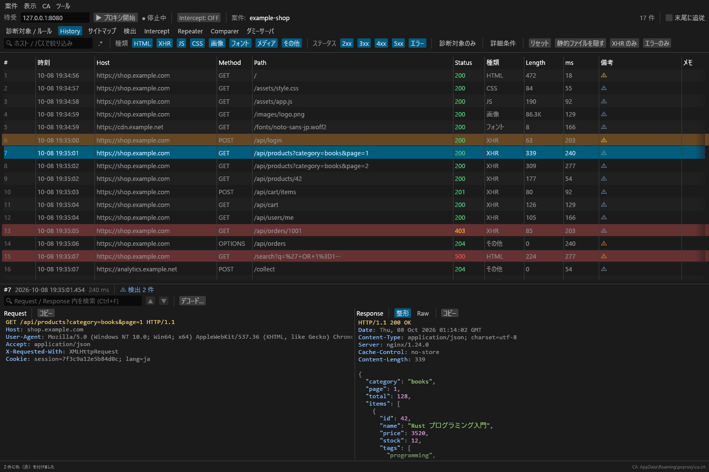
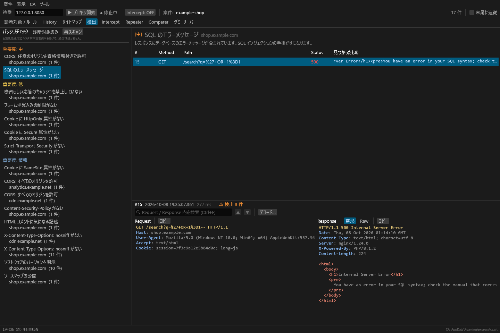
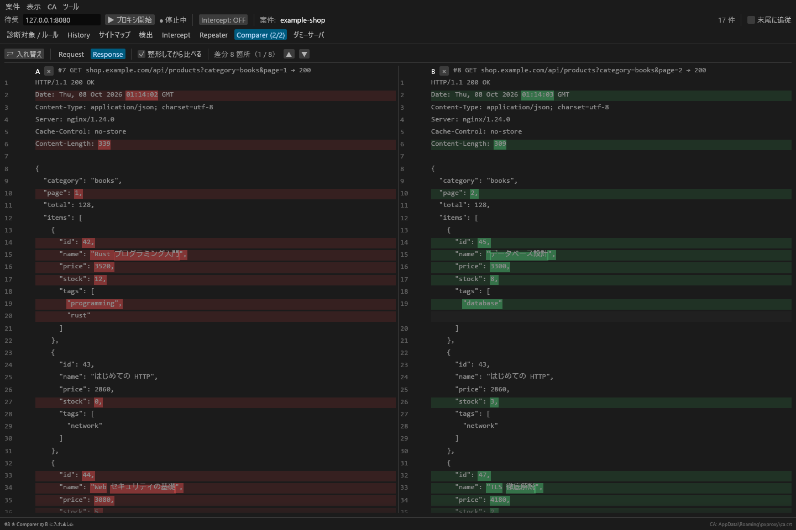

# pxproxy

**Rust で実装した高速なローカル Proxy**

ブラウザなどの HTTP / HTTPS 通信を手元で中継・記録し、閲覧・編集・再送できる診断用プロキシです。
GUI アプリ（`pxproxy`）と、GUI なしで動くコマンド（`pxproxy-cli`）があります。



## 特徴

- **HTTPS を復号して記録**: ローカル CA が接続先ごとに証明書を発行し、通信内容をそのまま確認できます。
- **ヘッダを書き換えない**: 自前の HTTP/1.x 実装で、ヘッダの大文字小文字・順序・重複を変えずに転送します。
- **速さを優先した設計**
  - tokio による非同期 I/O。接続ごとに独立して処理し、Intercept で止めた通信が他の通信を待たせません。
  - サーバ証明書の鍵を全ホストで共有し、発行した証明書はキャッシュします（ホストごとの鍵生成を省きます）。
  - 記録は専用スレッドへキューで渡し、まとめてトランザクションでコミットします。プロキシは DB への書き込みを待ちません。
  - Body は読んだそばからクライアントへ流します（Intercept で止める通信を除く）。大きなダウンロードや SSE も溜めずに届きます。
  - SQLite（WAL）にメタデータを保存します。大きな Body は blake3 で重複を除いたうえで zstd 圧縮して保存します。
- **案件単位で管理**: 1 案件 = 1 フォルダ。zip にまとめて受け渡しできます。

## 画面イメージ

冒頭の画像は History（記録した通信の一覧と詳細）です。画面に写っている通信は、すべて架空のものです。

**検出**: 記録した通信のパッシブチェック。選んだ検出に該当する通信と、その詳細を表示します



**Comparer**: 2 つの通信を左右に並べて、行と単語の単位で差分を表示します



## 機能

| 画面 | できること |
|---|---|
| History | 記録した通信の一覧と詳細。日時、ホスト / パス（正規表現も可）、種類（HTML・XHR・JS・CSS・画像など）、ステータス、診断対象で絞り込めます。「詳細条件」ではヘッダ・Body の全文検索（gzip などは展開して検索、正規表現・大文字小文字の区別も可）、メソッド、Response の長さ、所要時間、メモの有無、色でも絞り込めます。「メモ」列のダブルクリックで行ごとにメモを残せます。Ctrl / Shift+クリックで複数の行を選び、右クリックから行に色を付けたり、通信を削除（選択した行・一覧に表示中の行・診断対象外の通信）したりできます。右クリックメニューの詳細は下記 |
| 詳細表示 | JSON / HTML / XML の整形とシンタックスハイライト、GraphQL のリクエストはクエリと variables に分けて整形、Protobuf / gRPC はスキーマなしでデコードして表示、Request / Response 内の検索、画像のプレビュー、gzip / br / zstd / deflate の展開。Intercept で編集した通信は、編集前と編集後を切り替えて表示します。WebSocket に切り替わった通信は、送受信したメッセージを一覧できます |
| サイトマップ | 記録した通信をホスト → パスのツリーで表示します。ノードを選ぶと、その配下の通信だけを一覧します |
| Intercept | ルールに一致したリクエスト / レスポンスを止めて、編集・Forward・Drop できます（下記） |
| Repeater | リクエストを編集して何度でも送り直せます。送った内容と結果は ◀ ▶ で行き来できます（下記） |
| Comparer | 2 つの通信のリクエスト / レスポンスを左右に並べ、行と単語の単位で差分を表示します（History などで右クリック →「Comparer に送る」）。前 / 次の差分への移動、A と B の入れ替え、整形してから比べるかどうかの切り替えができます |
| 検出 | 記録した通信を調べるだけのパッシブチェックです。セキュリティヘッダの欠落、Cookie の属性、エラーメッセージ・SQL エラーの露出、URL 内の機密らしきパラメータ、パスワード・Basic 認証の平文 HTTP での送信、CORS の設定、内部 IP の露出、ソフトウェアのバージョンの開示、ディレクトリ一覧、JWT（alg: none・推測しやすい秘密鍵・有効期限なし）、キャッシュの禁止漏れ、ソースマップの公開、HTML コメント内の気になる記述、混在コンテンツなどを、チェックとホストでまとめて表示します |
| 診断対象 / ルール | 診断対象（Scope）のホスト・パス、Intercept の条件、上流プロキシ、TLS パススルー、接続の制限、記録する Body の上限を案件ごとに設定します |
| 上流プロキシ | 社内プロキシなどを経由して接続します（HTTPS は CONNECT、平文 HTTP は absolute-form、Basic 認証、直接つなぐホストの指定）。Repeater・TLS パススルー・`pxproxy-cli run` にも適用されます |
| TLS パススルー | 指定したホスト（ワイルドカード可）の HTTPS は復号せずにそのまま中継します。証明書ピンニングで失敗するアプリや、診断対象外の通信に使います |
| 接続の制限 | 上流への同時接続数と、1 秒あたりの新規接続数に上限を設けます（下記） |
| 透過プロキシ | プロキシ設定のできないアプリの通信も、iptables などで待受へ転送すれば記録できます（下記） |
| ダミーサーバ | 任意のドメインに、パスごとに応答を設定した仮想 Web サーバを用意します（下記） |
| hosts | hosts ファイルと同じ書式（`IP ホスト名…`、ワイルドカード可）で接続先の IP を案件ごとに上書きします。Host ヘッダ・SNI は元のまま。Repeater と `pxproxy-cli run` にも適用されます |
| エンコード / デコード | URL・Base64（エンコードは Base64URL も）・HTML エンティティ・Hex・Unicode エスケープの変換と、JWT のデコード。結果を入力欄に戻して続けて変換したり（二重エンコードなど）、Intercept・Repeater の編集欄で選んだ範囲を結果で置き換えたりできます |
| 案件 | 新規作成・開く・最近の案件・閉じる、zip へのエクスポート / zip からのインポート（メニューの「案件」） |
| 表示 | テーマ（システムに合わせる / ダーク / ライト）と文字の大きさ（画面・Request / Response）。案件ではなく利用者ごとの設定で、CA と同じフォルダの `ui.toml` に保存します |

## 機能の詳細

### History / サイトマップの右クリックメニュー

- Repeater に送る（Ctrl+R）/ Comparer に送る
- 行に色を付ける / 色を外す、メモを編集する（Enter で確定、Esc で取り消し）
- このホストを診断対象に追加 / 診断対象から除外
- このホストを TLS パススルーに追加（新しい接続から、復号せずに中継します）
- 通信の削除（選択した行・一覧に表示中の行・診断対象外の通信。確認してから削除します）

「備考」列には、エラー・Intercept で編集した通信・Repeater から送った通信・TLS パススルー・WebSocket・Body の切り詰め・パッシブチェックの検出が表示されます。

### Intercept

止める条件は「診断対象 / ルール」タブで設定します。

- 診断対象の通信だけ止める（既定: オン）
- 止めない種類（既定: CSS・画像・フォント・メディア）
- URL の正規表現（例: `/api/|\.php`、空なら全て）
- レスポンスもルールで止める。Content-Type に含む文字列（例: `html, json`）で絞り込めます。止めたリクエストごとに「このレスポンスも止める」を選ぶこともできます
- Body を編集したら Content-Length / chunked を自動で付け直す（既定: オン）
- 通信を止めたら Intercept タブへ切り替える

止めた通信は 1 件ずつ、または「すべて Forward」でまとめて流せます。
gzip などで圧縮された Body は「展開して編集」で平文にしてから編集できます（ヘッダの Content-Encoding も外します）。
編集中の内容は Repeater に送れます（止めたリクエストはそのまま残ります）。

### Repeater

- タブを複数開けます（History などから送るか、「＋」で空のタブを追加）。
- 宛先（`https://host:port`）は Host ヘッダとは別に指定します。
- Content-Length は自動で更新できます。応答を待っている間は送信を中止できます。
- バイナリの Body は編集できませんが、そのまま送れます。

### ダミーサーバ

任意のドメインに、パスごとのステータス・ヘッダ・Body と受け付けるメソッドを設定した仮想 Web サーバを用意します。パス `/` は必須で、パスには `*` と `?` のワイルドカードが使えます。

- プロキシに届いた通信のうちホスト名が一致するものには、上流へ接続せずに応答します（待受は増やさず、HTTP / HTTPS・ポートは問いません）。Repeater と `pxproxy-cli run` にも適用されます。
- Content-Type は一覧から選べます。レスポンスヘッダに Content-Type を書くと、そちらを優先します。Content-Length は Body から付けます。
- Body は手書きのほか、ファイルを指定してそのまま返せます（画像・バイナリ向け）。ファイルは応答のたびに読むので、差し替えるとすぐ反映されます。ファイルは zip エクスポートに含まれません。
- 手書きのレスポンスヘッダと Body には、次のプレースホルダでリクエストの内容を埋め込めます。値が無ければ空になります。

| プレースホルダ | 埋め込む内容 |
|---|---|
| `{{method}}` / `{{path}}` | メソッド / パス |
| `{{query}}` | QueryString 全体（`?` の後ろ、デコードしない） |
| `{{query.名前}}` | QueryString のパラメータの値（URL デコード後） |
| `{{body}}` | リクエストの Body 全体 |
| `{{form.名前}}` | `a=1&b=2` 形式の Body のパラメータの値（URL デコード後） |
| `{{json.a.b.0}}` | JSON の Body の値（文字列は中身、それ以外は JSON の表記） |
| `{{header.名前}}` | リクエストヘッダの値（大文字小文字を区別しない） |
| `{{html:…}}` / `{{url:…}}` / `{{json:…}}` | HTML エスケープ / URL エンコード / JSON 文字列の中身としてエスケープして埋め込む（例: `{{html:query.q}}`） |

### 接続の制限

ルータの IP フラッド検出などに引っかかる場合に、上流への接続を抑えます。

- 同時接続数の上限と、1 秒あたりの新規接続数の上限を設定できます（既定はどちらも 0 = 無制限）。
- 上限に達した通信は、空きが出るまで待ちます。待っている通信があるときは、keep-alive で使っていない接続から閉じます。
- 上限を緩めると、待っていた通信がすぐに流れます。Repeater の送信にも適用されます。

## 必要なもの

- Rust 1.88 以降（edition 2024）
- Windows（動作確認済み）。macOS / Linux でもビルドできる構成ですが、動作は未確認です

## ビルド

```sh
cargo build --release
```

`target/release/` に次の 2 つができます。

- `pxproxy`（Windows は `pxproxy.exe`）: GUI アプリ
- `pxproxy-cli`: GUI なしのコマンド

## はじめかた

1. `pxproxy` を起動し、「新規案件を作成」で案件を作ります（空のフォルダを「案件を開く」で選んでも、そのフォルダが新しい案件になります）。
2. 「▶ プロキシ開始」を押します（既定の待受は `127.0.0.1:8080`）。
3. ブラウザまたは OS のプロキシ設定を `127.0.0.1:8080` にします。
4. HTTPS を記録するには、CA 証明書を信頼済みのルート証明機関として登録します（下記）。
5. 通信すると History に記録されます。

### CA 証明書の登録

CA は初回起動時に自動で作られ、次の場所に保存されます。

- Windows: `%APPDATA%\pxproxy\ca.crt`
- その他: `$XDG_CONFIG_HOME/pxproxy/ca.crt`（`XDG_CONFIG_HOME` が未設定なら、カレントディレクトリの `pxproxy/ca.crt`）

メニューの「CA → CA 証明書を保存…」、または `pxproxy-cli ca -o pxproxy-ca.crt` で書き出し、
OS（またはブラウザ）の「信頼されたルート証明機関」に登録してください。

> [!WARNING]
> `ca.key` を持つ人は、この CA を信頼した端末の HTTPS 通信を偽装できます。`ca.key` は共有しないでください。
> 診断が終わったら、登録した CA を削除することをおすすめします。

### 透過プロキシ

プロキシ設定のできないアプリの通信は、iptables などで宛先を pxproxy の待受（例: `127.0.0.1:8080`）へ転送して記録します。
待受に CONNECT 無しで届いた通信は、次のように宛先を判断して中継します。通常のプロキシ要求と同じ待受で受け付け、モードの切り替えはありません。

- 平文 HTTP: `Host` ヘッダのホスト・ポート（ポート省略時は 80）
- HTTPS: TLS の SNI で証明書を発行し、`Host` ヘッダのホスト・ポート（ポート省略時は 443）へ転送します。`Host` が無ければ SNI を使います

pxproxy 自身から上流への通信が同じ転送ルールに掛かると無限ループになるため、転送の対象から除外してください
（iptables の `-m owner ! --uid-owner` など）。上流が pxproxy の待受そのものに解決される場合は、502 とエラーを返して記録します。
## キーボードショートカット

| キー | 画面 | 動作 |
|---|---|---|
| ↑ / ↓ | History / サイトマップ | 行を移動 |
| Ctrl+クリック / Shift+クリック / Ctrl+A | History / サイトマップ | 行を追加・解除 / 範囲で選択 / すべて選択 |
| Delete | History / サイトマップ | 選択中の通信を削除（確認あり） |
| Ctrl+F | History / サイトマップ / 検出 | 詳細の検索欄へ（Enter で次、Shift+Enter で前） |
| Ctrl+R | History / サイトマップ / 検出 / Intercept | 選択中のリクエストを Repeater に送る |
| Ctrl+F / Ctrl+D | Intercept | Forward / Drop |
| Ctrl+Enter | Repeater | 送信 |
| Alt+← / Alt+→ | Repeater | 前 / 次に送った内容へ |

## コマンドラインからの起動

### GUI（pxproxy）

```sh
pxproxy [案件フォルダ] [オプション]
```

| オプション | 説明 |
|---|---|
| `案件フォルダ` | 起動時に開く案件。無ければ作成します |
| `-l, --listen <アドレス>` | 待受アドレス（既定: `127.0.0.1:8080`） |
| `-s, --start` | 起動と同時にプロキシを開始します（案件の指定が必要） |
| `-h, --help` / `-V, --version` | 説明 / バージョンを表示します |

```sh
# 案件を開いて、すぐ 8888 番で記録を始める
pxproxy ./webapp.pxproj --listen 127.0.0.1:8888 --start
```

### GUI なし（pxproxy-cli）

```sh
pxproxy-cli run <案件フォルダ> [-l <アドレス>] [--create] [-q]   # 記録しながら待ち受け（Ctrl+C で終了）
pxproxy-cli export <案件フォルダ> <出力.zip>                    # 案件を zip にまとめる
pxproxy-cli import <入力.zip> <展開先フォルダ>                  # zip を案件フォルダに展開する
pxproxy-cli ca [-o <ファイル>]                                  # CA 証明書 (PEM) を表示 / 保存
```

`run` は通信ごとに 1 行ずつ標準出力に表示します（`-q` で表示しません）。

```text
$ pxproxy-cli run ./webapp.pxproj --create
pxproxy-cli: 127.0.0.1:8080 で待ち受け中（Ctrl+C で終了）
200 GET     https://example.com/  42 ms  1.2K
404 GET     https://example.com/missing  18 ms  335B
```

記録した案件は、あとから GUI で開いて閲覧できます。CA は GUI と共通です。
同じ案件を GUI と `pxproxy-cli run` で同時に開かないでください。

## 案件フォルダ

```text
<name>.pxproj/
├─ project.toml      フォーマットのバージョンなど
├─ settings.toml     診断対象 / Intercept のルール / hosts
├─ project.sqlite    通信のメタデータ（WAL）
└─ bodies/ab/cd/<blake3>.zst   大きな Body（zstd 圧縮、内容のハッシュで重複を除く）
```

パスはすべて相対なので、フォルダごとコピーしても、zip にまとめても移動できます。
zip のエクスポート / インポートはバックグラウンドで実行し、途中で中止できます。

## 構成

| クレート | 役割 |
|---|---|
| `px-proxy` | MITM プロキシ本体（HTTP/1.x、TLS、CA、Intercept、Repeater の送信） |
| `px-store` | 案件の保存（SQLite + Body ストア、zip の入出力） |
| `px-app` | GUI（egui / eframe）。バイナリ名は `pxproxy` |
| `px-cli` | GUI なしのコマンド。バイナリ名は `pxproxy-cli` |

## 制限事項

- HTTP/2 には対応していません（ALPN で HTTP/1.1 を使います）。
- 透過プロキシは宛先を `Host` / SNI で判断します。元の宛先アドレスを OS から取得する方式（Linux の `SO_ORIGINAL_DST` など）には対応していません。SNI の無い TLS は中継できません。
- WebSocket は記録と表示のみで、メッセージの Intercept・再送はできません。
- 記録する Body の上限（既定 32 MB）を超えた分は記録しません。Intercept で止める通信は Body 全体をメモリ上で扱います。
- パッシブチェックは、この機能より前に記録した通信も案件を開いたときにバックグラウンドで順に調べます（「検出」タブの「再スキャン」でやり直せます）。
- Repeater のタブは保存されません（送った通信は History に残ります）。

## 開発

```sh
cargo test --workspace
cargo clippy --workspace --all-targets
```

README の画面イメージ（`docs/images/`）は、架空の通信を記録した案件を描画して作ります。画面を変えたら作り直してください。

```sh
cargo test -p px-app readme_screenshots -- --ignored
```
